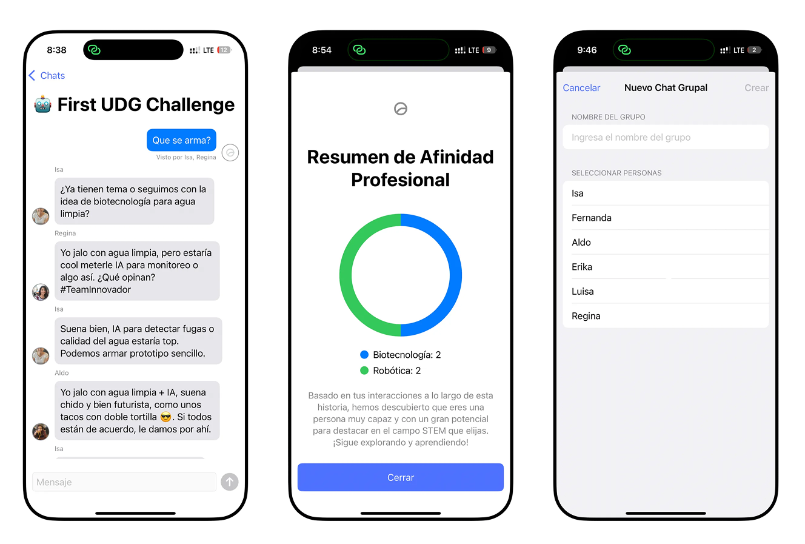

# Ingenia


Ingenia is a SwiftUI chat experience that blends character-driven storytelling with STEM career discovery. The app simulates a WhatsApp-style interface where users chat with multiple agents, while an orchestrator quietly tracks intent and updates STEM affinity scores based on the conversation.


    
---

## Features

- **Multi-agent chat experience** with distinct personas, avatars, and messaging styles.
- **Direct messages and group chats** with stacked avatar previews and customizable group creation.
- **Orchestrator-driven intent tracking** that evaluates user messages, updates objectives, and computes STEM career affinities.
- **Career affinity summary** with a donut chart visualization once progress is complete.
- **Message seen status** tracking for user messages in channels.
- **SwiftUI-first architecture** leveraging `NavigationSplitView`, sheets, and observable state.

## Tech Stack

- **SwiftUI** for the interface and navigation.
- **Swift Concurrency (`async/await`)** for agent responses and message processing.
- **OpenAI-compatible API clients** for LLM responses and embeddings (configured via environment variables).

## Getting Started

### Prerequisites

- macOS with **Xcode 15+**.
- An **OpenAI API key** (or compatible API endpoint) exposed as an environment variable.

### Setup

1. Clone this repository.
2. Open `Ingenia.xcodeproj` in Xcode.
3. Set the environment variable in your scheme:
   - `OPENAI_API_KEY=your_key_here`
4. Build and run the `Ingenia` target.

## Project Structure

```
Ingenia/
├── Assets.xcassets
├── ContentView.swift
├── IngeniaApp.swift
├── Models/
├── Protocols/
├── ViewModels/
└── Views/
```

## License

See [LICENSE](LICENSE).
